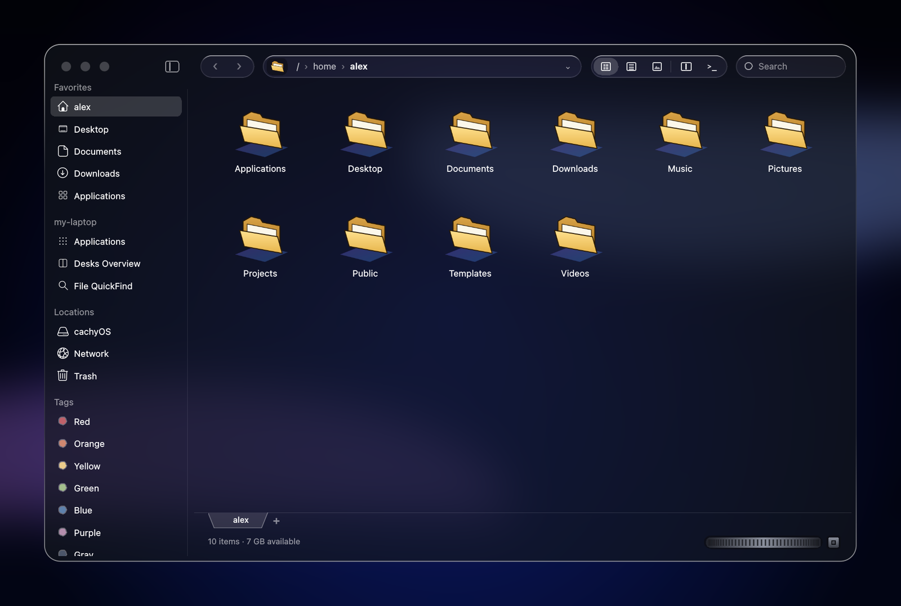
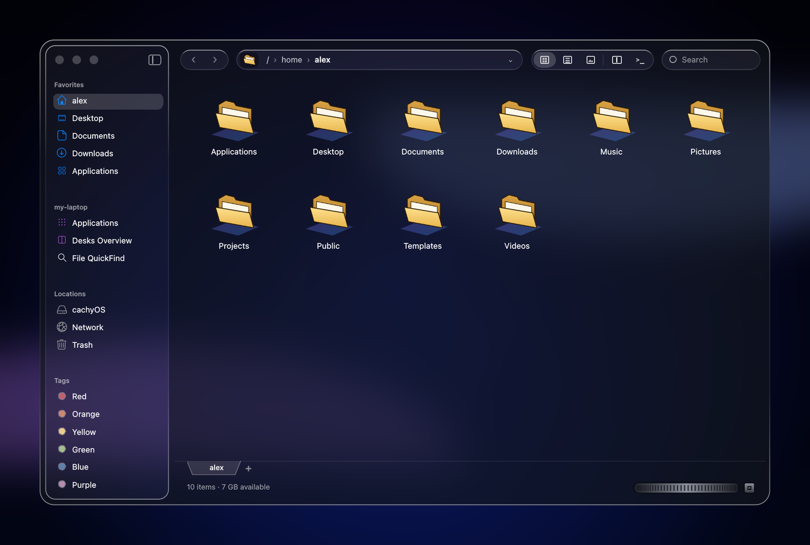
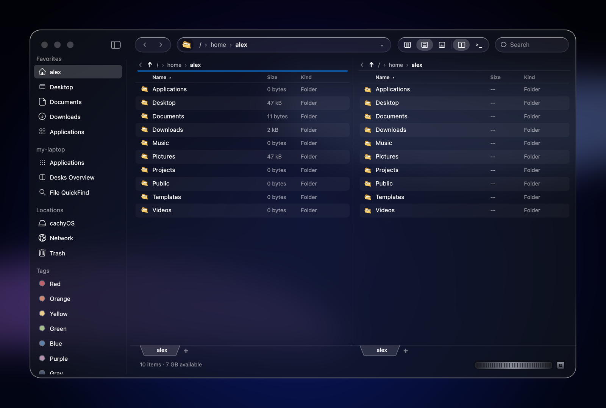
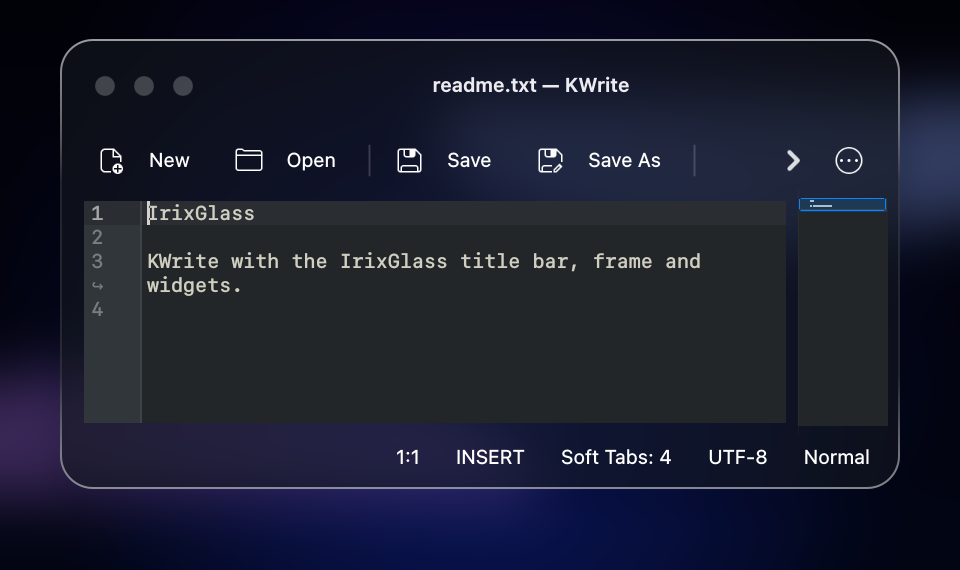
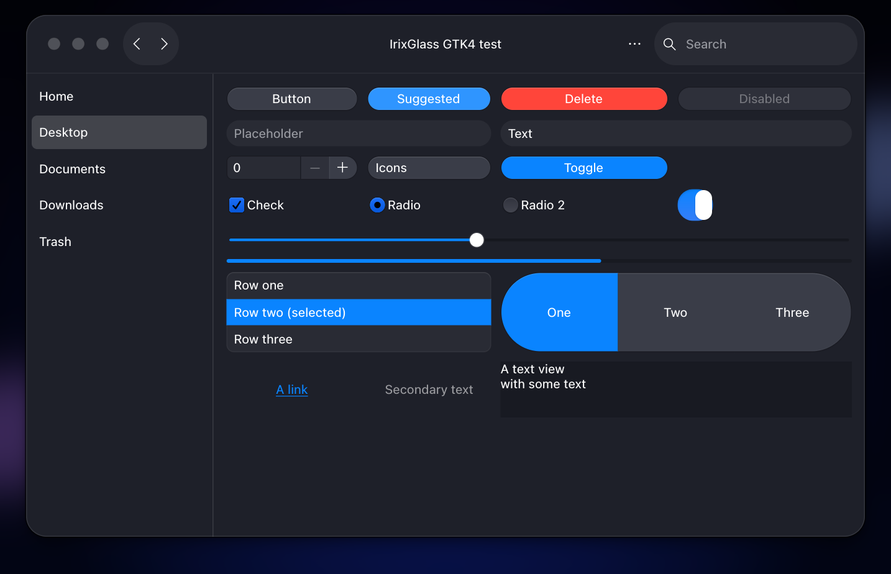
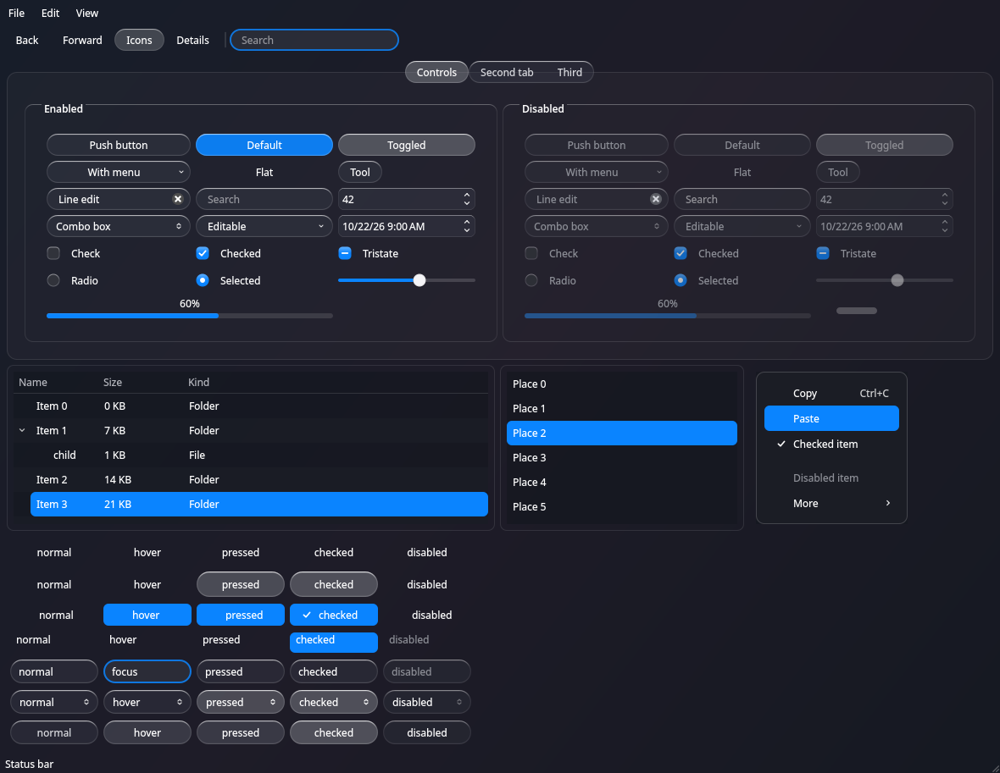
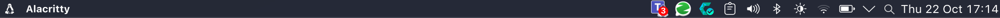
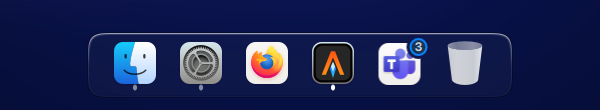

# IrixGlass desktop

A macOS Tahoe ("Liquid Glass") look for **KDE Plasma 6** on Wayland, built around **fm**, an
IRIX Indigo Magic–style file manager with the same glass skin. fm sets the look for everything
else: window title bars, Qt and GTK widgets, Plasma pop-ups, Firefox and Teams all copy its glass,
colours and red/yellow/green buttons, rendered here as grey circles. Made and tested on CachyOS (Arch).



## Screenshots

| | |
|---|---|
|  |  |
| fm with the Finder-style sidebar (View ▸ Sidebar Style) | Split view (F3), list view with columns |
|  |  |
| A KDE app: IrixGlass title bar, frame and Kvantum widgets | A GTK 4 app with the IrixGlass-Dark GTK theme |



Menu bar and dock:





The pictures use a generated gradient, not Apple's wallpaper; the `wallpaper` step downloads that
one at install time.

## What's in it

- **fm** (`fm/`): the file manager, which replaces Dolphin. It has IRIX notebook tabs, a split view, Finder
  tags and columns, Quick Look, terminal and Neovim tabs, web tabs, KIO network folders, a resizable
  sidebar in Dolphin or Finder style, and the SGI thumbwheel. See [fm/README.md](fm/README.md).
- **IrixGlass**: fm's look for everything else.
  - KWin title bars and frame (Aurorae, `theme/gen-decoration.py`)
  - Qt widgets (Kvantum, `theme/gen-kvantum.py`)
  - GTK 3/4 (`theme/gen-gtk.py`)
  - Plasma pop-ups, tooltips and OSDs (`theme/gen-plasma-dialogs.py`)
  - colour scheme (`configs/color-schemes/IrixGlass.colors`)
  - Firefox and Teams CSS (`configs/`)
- **Desktop**: macOS-style top menu bar and floating dock (`scripts/panels.js`, `theme/gen-panel-background.py`),
  the WhiteSur icons and cursors, SF Pro / SF Mono, Spotlight-style KRunner and a KWin window menu.
- **Terminal**: Alacritty, tmux and LazyVim in Nord.

## Install

```bash
git clone https://github.com/christianmeier/irixglass-desktop.git
cd irixglass-desktop
scripts/install.sh packages     # lists the pacman packages to install with sudo
sudo pacman -S --needed kvantum teams-for-linux neovim lazygit tree-sitter-cli 7zip
scripts/install.sh all          # everything below, in order (no sudo used)
```

Then log out and back in. Each step can also be run on its own: `scripts/install.sh <step> [<step> ...]`.

| Step | What it does |
|---|---|
| `packages` | Lists the system packages, which have to be installed with sudo, and warns about any that are missing |
| `whitesur` | Installs the WhiteSur KDE theme (dark and Liquid), icons, cursors and prebuilt GTK theme, and fixes broken names in the Liquid global themes |
| `fonts` | Downloads SF Pro and SF Mono from Apple and unpacks them into `~/.local/share/fonts/apple` |
| `theme` | Builds the custom dock and menu bar background (`theme/gen-panel-background.py`: squircle corners, crisp 1-pixel edges), removes the grey squares behind dock icons (`theme/patch-tasks.py`), and turns off panel blur, which caused stair-step artifacts at the corners. Preview a change first with `theme/preview.py`. Also builds **IrixGlass**, fm's look for all windows: the Aurorae title bar and frame (`theme/gen-decoration.py`), the Kvantum widget style (`theme/gen-kvantum.py`), the GTK theme IrixGlass-Dark (`theme/gen-gtk.py`), the Plasma pop-ups/tooltips/OSDs (`theme/gen-plasma-dialogs.py`) and the colour scheme (`configs/color-schemes/IrixGlass.colors`) |
| `apply` | Applies the IrixGlass colours, Plasma style, IrixGlass-Dark GTK theme, IrixGlass title bars (macOS button order, Aurorae v2, border size Large), icons, cursor, Kvantum style, SF fonts, macOS-style text rendering and GTK settings |
| `panels` | **Replaces all panels** with the top menu bar and the floating dock (`scripts/panels.js`), then restarts plasmashell |
| `kwin` | Installs the KWin script that adds a "Move & Resize" menu to the window menu |
| `search` | Sets Meta+Space to open KRunner in a centered pop-up (Spotlight-style), shows apps then files, and turns on Baloo file-name indexing |
| `firefox` | Installs the WhiteSur Firefox theme (tabs in their own row) with the IrixGlass override (`configs/firefox/customChrome.css`, `userContent-irixglass.css`: fm's colours, pills, traffic lights) into each `*.default-release` profile and hides the built-in VPN button |
| `terminal` | Installs the tmux config (Ctrl-a prefix, Nord, mouse), Alacritty config (Nord, Noto Sans Mono 12) and LazyVim with Nord |
| `teams` | Installs the teams-for-linux themes (IrixGlass active, Nord kept) |
| `zapzap` | Installs WhatsApp (ZapZap AppImage, unpacked into `~/Applications/ZapZap`) and its launcher entry |
| `wallpaper` | Downloads the macOS 27 "Golden Gate Dark" wallpaper to `~/.local/share/wallpapers/macos/` and sets it |
| `appimageupdate` | Installs AppImageUpdate (GUI and `appimageupdatetool`) into `~/Applications/AppImageUpdate`, a menu entry, and `~/.local/bin` on fish's PATH |
| `craft` | Installs the 14 storytold Craft apps (PhotoCraft, WordCraft, …) as checksum-verified AppImages with menu entries (`scripts/install-craft-app.sh`), and keeps Firefox and Haruna as the default PDF and MP3 apps |
| `irixfm` | Checks the build packages (`libvterm`, `kpty`, `syntax-highlighting`, `qt6-webengine` and the rest of fm's README list), builds and installs fm from `fm/` (`make install`) and makes it the default file manager, which the dock follows. A running fm keeps the old build until it's restarted: `pkill -TERM -x irixfm`, then `systemd-run --user --collect ~/.local/bin/irixfm` |

Before overwriting a file, the script copies it to `~/.config/appearance-backup-<timestamp>/`.
**`panels` replaces all your panels**, so run it on purpose.

## Manual steps (need your password)

These can't be scripted without sudo, so run them yourself:

| What | How |
|---|---|
| Dark login screen | System Settings → Login Screen → **Apply Plasma Settings…** (copies the dark colours, fonts, icons and cursor). Re-run after changing the desktop theme |
| Login screen wallpaper | Same page → **Configure Appearance…** → pick `~/.local/share/wallpapers/macos/Golden-Gate-Dark.png` → **Apply** |
| Fingerprint login | `sudo cp configs/pam/plasmalogin /etc/pam.d/plasmalogin`. At login, type the password as usual, or leave it empty, press Enter and touch the reader. Undo with `sudo rm /etc/pam.d/plasmalogin` |

sudo already accepts the fingerprint (set up by CachyOS), and so does the lock screen.

## Layout

```
fm/              the file manager (own README, CLAUDE.md, tests: make -C fm test)
theme/           generators: dock/menu bar, title bars, Kvantum, GTK, Plasma pop-ups
configs/         config files the installer copies (Firefox, Teams, Alacritty, tmux, Kvantum, …)
scripts/         install.sh, panels.js, install-craft-app.sh
kwin-scripts/    macos-window-menu KWin script
docs/            SESSION-NOTES.md (history, gotchas), screenshots/, mockups/ (the design fm came from)
.claude/skills/  Claude Code skills (macos-desktop here, irixfm in fm/)
```

## Working on it with Claude Code

```bash
cd irixglass-desktop && claude      # the desktop theme: reads CLAUDE.md, macos-desktop skill
cd irixglass-desktop/fm && claude   # fm: reads fm/CLAUDE.md, irixfm skill
```

`docs/SESSION-NOTES.md` has the full history of how this was built, and why.

## Credits and licence

GPL-3.0-or-later (see `LICENSE`). The installer downloads, and this repo doesn't include:
- [WhiteSur](https://github.com/vinceliuice) KDE, GTK, icon and cursor themes by Vince Liuice (GPL-3.0); IrixGlass is generated from them
- Apple's SF Pro / SF Mono fonts and the macOS wallpaper, from Apple, under Apple's terms
