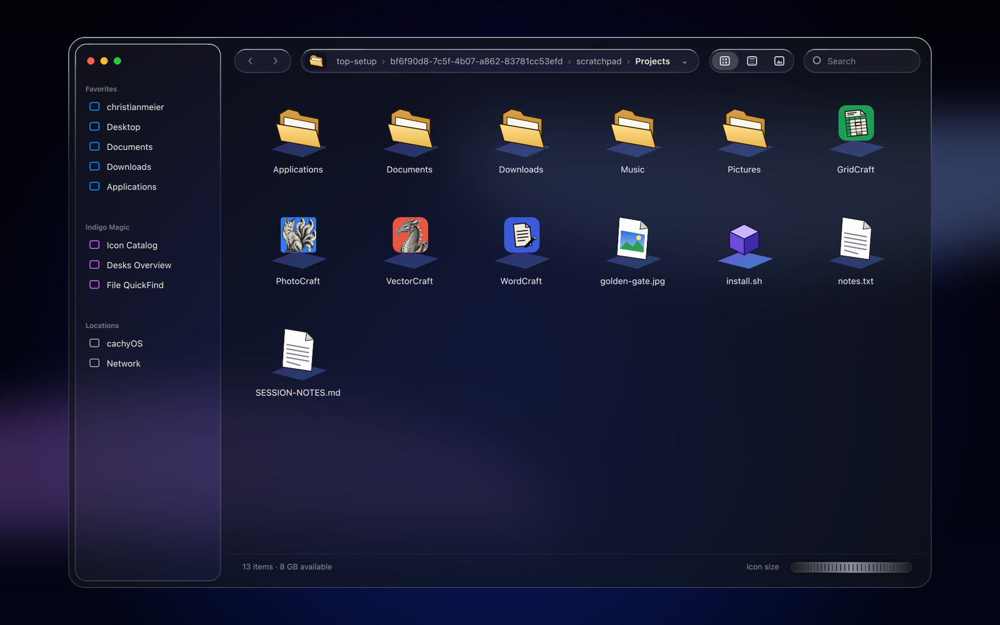
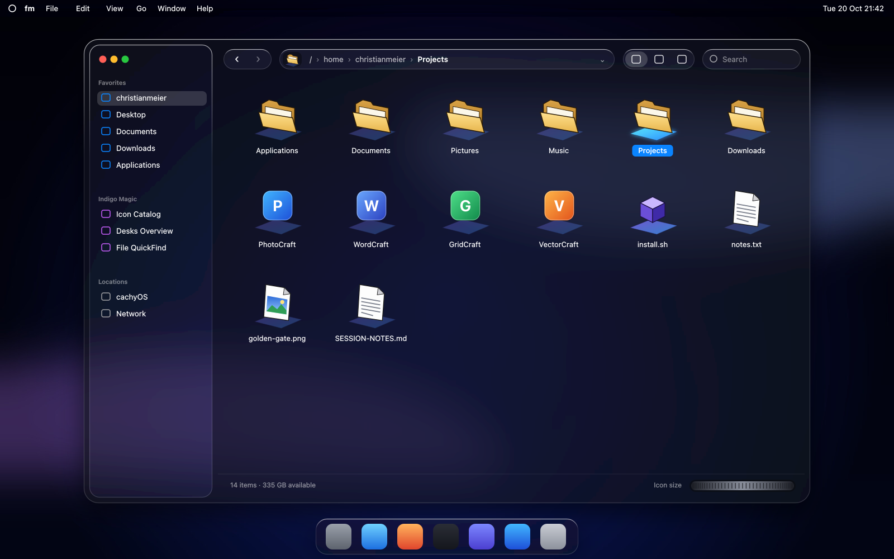

# fm: IRIX file manager, Tahoe edition

A small file manager for KDE Plasma 6 that brings back the SGI IRIX *Indigo Magic* `fm`
look and wraps it in macOS Tahoe "Liquid Glass".



It follows this mockup (layout A), drawn first and then built to match. Text, buttons and menus use
the same sizes and style as your other windows, and the dock shows your icon theme's normal file
manager icon; the IRIX icons are only inside the window.



## What's IRIX and what's Tahoe

| From IRIX `fm` | From macOS Tahoe |
|---|---|
| Tilted Indigo Magic icons on coloured "magic carpet" bases; the selected one glows | Frameless glass window with KWin blur behind it, 26 px corners |
| Drop pocket: the current folder's icon in the path bar, drag it out to drag the folder | Floating sidebar and pill-shaped toolbar, edges lit from the top |
| SGI thumbwheel to scale the icons | Traffic-light buttons, blue selection pill, SF Pro text |
| "Indigo Magic" places: Icon Catalog, Desks Overview, File QuickFind | Global menu bar: File, Edit, View, Go, Window, Help |

## Features

- Icon, list and preview views (preview mode shows the real picture on the icon).
- Back/forward history, clickable path, history menu (⌄), search-as-you-type filter.
- Editable path bar ("Go to Folder"): click the path (or press Ctrl+L / Ctrl+Shift+G, or type `/` or `~`),
  type a path (`~`, relative, `file://`), Tab completes folder names (the rest shows greyed out),
  Enter goes there; a file opens its folder and selects it; a wrong path flashes red.
- Editable sidebar: add folders to Favorites, Indigo Magic or Locations (the + on a section title,
  drag a folder onto it, right-click → Add to Sidebar, or Add Folder…), remove with the ⊖ that shows
  on hover, rename by double-clicking, and right-click for move up/down, move to another section,
  remove and Reset Sidebar. It scrolls when the window is short.
- Select by click, Ctrl/Shift-click or rubber band; drag files out to other apps, drop files in (Shift moves).
- Open with the default app (KIO, same as Dolphin), run `.desktop` launchers, rename inline (F2),
  new folder, copy/paste, Move to Trash, open a terminal or Dolphin at the current folder.
- Finder commands: Quick Look (Space: pictures, PDFs, video/audio, text, folders), Get Info (Ctrl+I),
  Duplicate (Ctrl+D), Make Alias, Show Original (Ctrl+R), Move Item Here (Ctrl+Alt+V), Undo (Ctrl+Z),
  type to select, Sort By (click a list column or View ▸ Sort By). Plan and status of every Finder
  feature: [docs/FINDER-FEATURES.md](docs/FINDER-FEATURES.md).
- More Finder: Trash in the sidebar (Put Back, Empty, Delete Immediately), Open With, USB drives with
  Eject, spring-loaded folders, hide the sidebar (Ctrl+Alt+S), preview pane (Ctrl+Shift+P), search
  through subfolders (scope bar: this folder / subfolders / Home), folder sizes in the list,
  Compress / Expand, Recent Folders.
- Icon Catalog shows `/usr/share/applications` with each app's real icon and name.
- Two-finger touchpad scrolling in the icon and list views, and over the icon-size thumbwheel
  (up/down or sideways). A mouse wheel works too.
- Remembers icon size, view mode, hidden files and window size.

## Requirements

KDE Plasma 6 on Wayland (KWin draws the blur and the shadow), Qt 6.8 or newer, KDE Frameworks 6.
On Arch / CachyOS:

```
sudo pacman -S --needed base-devel qt6-declarative qt6-multimedia qt6-webengine kio kwindowsystem kirigami karchive solid plasma-integration
```

The text uses **SF Pro Text** if it's installed and falls back to the system font otherwise.

## Build and install

No cmake needed: the Makefile uses `g++` and `pkg-config`.

```
make              # build ./build/irixfm
make run          # run from the source tree
make test         # scroll, path bar, sidebar and Finder-feature tests, off-screen (100 checks)
make install      # into ~/.local (bin, share/irixfm, menu entry "fm")
make uninstall
```

A `CMakeLists.txt` is included as well (`cmake -B build && cmake --build build && cmake --install build`).

Start it from the app menu ("fm") or with `irixfm [folder]` (a file opens its folder).

### Make it the default file manager

```
xdg-mime default irixfm.desktop inode/directory          # folders open in fm; the Plasma dock's file manager follows
xdg-mime default org.kde.dolphin.desktop inode/directory # back to Dolphin
```

"Show in folder" in other apps still goes to Dolphin (fm doesn't implement the
`org.freedesktop.FileManager1` D-Bus interface yet).

## Keys

| Key | Action |
|---|---|
| Enter / double-click, Ctrl+O, Ctrl+↓ | Open |
| Space | Quick Look (arrows step through items, Esc closes) |
| Type letters | Select the item whose name starts with them |
| Backspace, Ctrl+↑, Alt+↑ | Enclosing folder |
| Ctrl+[ / Ctrl+], Alt+← / Alt+→ | Back / forward |
| Ctrl+I | Get Info |
| F2 | Rename |
| Ctrl+D | Duplicate |
| Ctrl+R | Show Original (of an alias) |
| Del, Ctrl+Backspace | Move to Trash |
| Ctrl+Z | Undo |
| Ctrl+C / Ctrl+V / Ctrl+Alt+V / Ctrl+A | Copy / paste / move here / select all |
| Ctrl+Alt+C | Copy path |
| Ctrl+Shift+D / O / A / C / H, Ctrl+Alt+L | Desktop / Documents / Applications / Computer / Home, Downloads |
| Ctrl+Shift+N | New folder |
| Ctrl+F | Search |
| Ctrl+L, Ctrl+Shift+G, `/`, `~` | Type a path (Tab completes, Esc cancels) |
| Ctrl+Shift+., Ctrl+H | Show hidden files |
| Ctrl+Alt+S / Ctrl+Shift+P | Hide sidebar / show preview pane |
| Ctrl+Alt+Z | Compress |
| Ctrl+Shift+Del | Empty Trash |
| Ctrl+1 / 2 / 3 | Icons / list / previews |
| Ctrl++ / Ctrl+- / Ctrl+wheel | Bigger / smaller icons (or roll the thumbwheel: drag, scroll or swipe over it) |
| Ctrl+N / Ctrl+W | New window / close window |

## Layout of the code

How it works, design rules and gotchas: [docs/DEVELOPMENT.md](docs/DEVELOPMENT.md).

```
src/            C++: window blur, input mask and shadow (KWindowEffects, KWindowShadow), KIO file actions
qml/Main.qml    the whole window; geometry is the mockup's, in mockup pixels times `u` (0.85)
qml/*.qml       Quick Look, Get Info window, preview pane, glass edge ring, toolbar pill, traffic lights, thumbwheel, inline rename, glass scroll bar
icons/          generated SVG layers: carpets (normal, executable, selected) and glyphs
tests/          scroll_test, path_test, sidebar_test, finder_test, phase2_test (make test)
tools/          make_icons.py (icons), make_mockup.py (docs/mockup.png)
```

`IRIXFM_SNAPSHOT=out.png irixfm <dir>` renders the window to a PNG and quits, which is handy for
checking the look without touching the screen.

## Known limits

- No licence file yet: pick one before publishing.
- Plasma/KWin only: the blur and shadow use KDE protocols. Elsewhere the window is plain translucent.
- No tabs, no column view, no network browsing (Network opens Dolphin at `remote:/`).
- Desks Overview triggers KWin's Overview effect.
